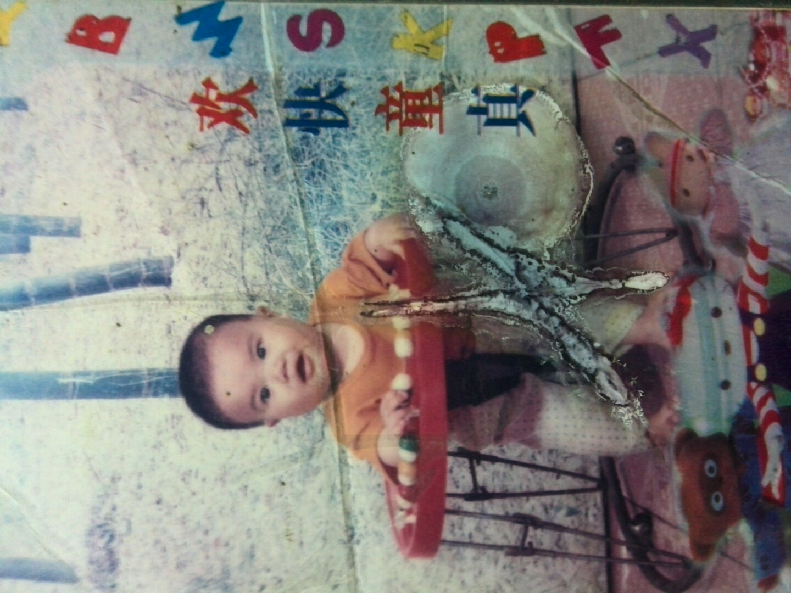
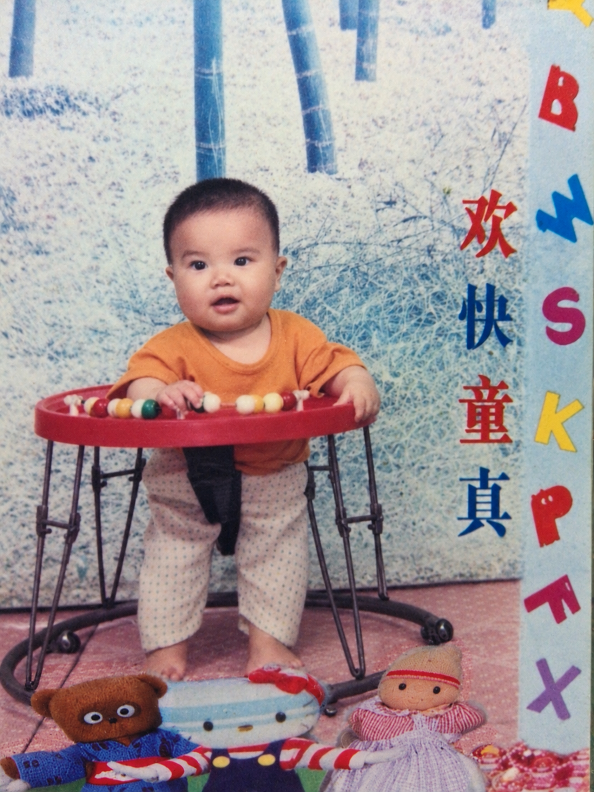

# 迭代式老照片保真修复 / faithful iterative old photo restoration

## 中文

保留人物特征与原始构图，去除污渍和划痕，逐轮检查、改进。

使用 [中文版 Skill](SKILL.md)，提供自己的老照片，并告诉 AI：

> 读取并执行 `SKILL.md`，修复我提供的老照片。

更多实用 AI 技巧，关注小红书 **@寒江钓雪**。

## English

Preserve identity and composition, remove stains and scratches, and review and improve each restoration round.

Use the [English Skill](SKILL-ENG.md), provide your own old photo, and tell your AI:

> Read and follow `SKILL-ENG.md` to restore the old photo I provide.

For more practical AI tips, follow **@寒江钓雪** on Xiaohongshu (RedNote).

下方左图为修复前，右图为修复后。 / Below, the original is on the left and the restored photo is on the right.

  
  &nbsp;&nbsp;
  

示例仅展示效果，使用时无需这些图片。 / These examples illustrate the result; they are not required to use the Skill.
